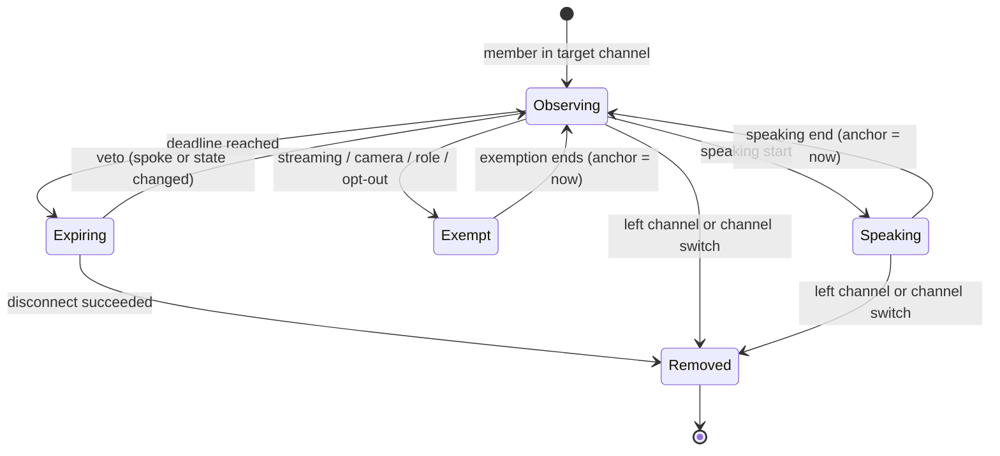
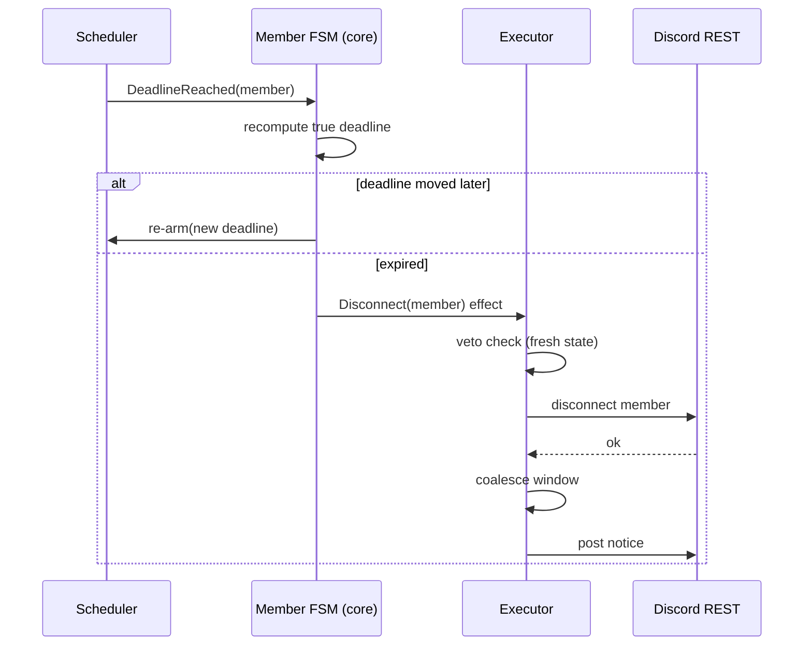

# Architecture

## 1. Principles
1. **Pure core, thin adapters.** Decision logic never touches Discord, Redis, or the system clock. It takes events and a `Clock`, and returns new state plus effects as data.
2. **Events in, effects out.** Everything is a deterministic function of the event trace, so any bug can be reproduced by replaying a trace.
3. **Observe before you act.** Silence only counts when it was actually observed.
4. **Fail safe.** When unsure (reconnects, missing permissions, stale state), do nothing rather than disconnect someone wrongly.

## 2. Layers and components

| Layer | Component | Responsibility |
|---|---|---|
| Core (pure) | Election | Choose the target channel with hysteresis |
| Core (pure) | Member FSM | Track each member's silence state and emit effects |
| Core (pure) | Deadline scheduler | Heap of deadlines, lazy re-arm, injectable clock |
| Core (pure) | Policy | `RulesPolicy` (baseline); `ModelPolicy` later (Phase 6) |
| App | Guild actor | Serial mailbox per guild; wires events to core and effects to adapters |
| Adapter | Gateway listener | `voiceStateUpdate`, channel and guild events to domain events |
| Adapter | Voice manager | Join/leave/switch, reconnect with backoff, speaking events |
| Adapter | Executor | Veto check, disconnect, notice coalescing, retries |
| Adapter | State store | Redis persistence and rehydration |
| Adapter | Observability | pino logs, Prometheus metrics, `/healthz` |
| Tooling | Simulator | Fake gateway + fake clock + seeded RNG; trace record/replay |

## 3. Concurrency model
Each guild has a **mailbox**: a serial queue of events processed one at a time by that guild's actor. Because the core is pure, serial processing removes races between "speaking end", "deadline reached", and "member left". Guilds are isolated from each other, so one guild's failure cannot corrupt another's state.

## 4. Key algorithms

### 4.1 Target channel election
Inputs: guild snapshot (humans per eligible channel), election state (`incumbent`, `enteredAt`, `challenger`, `challengerSince`), `now`, config.

1. Build candidates (FR-1) and sort by (humans desc, recent speech desc, channel ID asc).
2. If the incumbent is invalid (deleted, inaccessible, or below `MIN_HUMANS`): switch immediately to the best candidate with at least `MIN_HUMANS`, or go idle if none.
3. Otherwise let `best` be the top candidate other than the incumbent. If `best.humans >= incumbent.humans + SWITCH_MARGIN`, start (or continue) the challenger timer; else clear it.
4. Switch only when the challenger has led continuously for `ELECTION_STABLE_SECONDS` and `now - enteredAt >= MIN_DWELL_SECONDS`.
5. Output: `Stay`, `Switch(to)`, or `GoIdle`, plus updated election state. On any switch the guild actor cancels pending effects for the old channel.

Why: counts fluctuate constantly. Without margin, stability, and dwell, the bot would hop between channels and reset everyone's clocks.

### 4.2 Silence deadline
For each tracked member:

```
anchor    = max(observationStart, lastSpeakingEnd)
deadline  = anchor + SILENCE_THRESHOLD + blindCredit        (if not speaking and not exempt)
deadline  = none                                             (if speaking or exempt)
```

- `speaking start` sets `speaking = true` (deadline cleared).
- `speaking end` sets `speaking = false`, `anchor = now`, `blindCredit = 0`.
- This is what prevents a long monologue from expiring: the clock only runs while the member is not speaking.

### 4.3 Lazy deadline scheduler
- A min-heap holds `(memberId, deadlineAtEnqueue)`. One timer is armed for the earliest deadline.
- Speaking events do **not** touch the heap; they only update the member's anchor (O(1)).
- When the timer fires, the scheduler pops the entry and **recomputes the true deadline**. If it moved later, the entry is re-inserted (re-arm). If it is due, an `Expire` event is emitted.
- Properties: zero wakeups when nothing is tracked; wakeups scale with members, not with wall time; stale heap entries are harmless because the true deadline is always recomputed.
- Honest note: with at most about 99 members per channel, a once-per-second scan would also perform fine. This design is chosen for determinism, zero idle cost, and testability, and the benchmark in `docs/METRICS.md` quantifies the difference rather than assuming it.

### 4.4 Blind-interval accounting
- The voice manager reports `BlindStart` when a connection drops or the process stops, and `BlindEnd` when observation resumes.
- On `BlindEnd(duration)`: for every tracked member, `blindCredit += duration`, and every `speaking` flag is cleared (the end event may have been missed).
- On process restart: persisted wall-clock timestamps are loaded, downtime is treated as one blind interval, and state is reconciled with live voice states before any action.
- Result: a member is never disconnected for silence the bot could not have heard.

### 4.5 Action pipeline
`Expire` event, then FSM emits `Disconnect(member)` effect, then Executor:
1. **Veto check:** fresh read of member state (still in target channel, not exempt, no new signal, deadline still passed).
2. **Disconnect** with retries (max 3, exponential backoff with jitter, honoring `retry-after` on 429).
3. **Notify** only on success; notices within `NOTICE_COALESCE_MS` are merged.
4. Record outcome, metrics, and decision trace.

## 5. Member state machine



## 6. Expiry sequence



## 7. Persistence (Redis)
- `afkguard:v1:guild:{guildId}` (hash): `targetChannelId`, `election` (JSON), `updatedAtWall`, `schemaVersion`.
- `afkguard:v1:guild:{guildId}:members` (hash): `memberId` to JSON `{anchorWall, blindCredit, speaking, exempt}`.
- All keys carry a TTL (`STATE_TTL_SECONDS`). Schema is versioned; unknown versions are ignored (cold start) rather than trusted.
- Durations use a **monotonic clock** in memory; **wall-clock** timestamps are persisted and converted on hydrate.
- If Redis is down, the bot keeps running from memory, marks itself degraded, and retries; it never crashes because of Redis.

## 8. Failure modes

| Failure | Detection | Response |
|---|---|---|
| Voice websocket drop | Connection state change | Backoff with jitter; blind interval (4.4) |
| DAVE/decryption problems | Reconnect loops, no speaking events | Alert metric; fail safe (no actions while blind); pinned library version |
| Gateway disconnect/resume | discord.js events | Blind interval; reconcile on resume |
| Discord 429 | HTTP status | Honor `retry-after`; coalesce notices |
| Discord 5xx | HTTP status | Retry with backoff, max 3 |
| Missing permission | Preflight and API errors | Degrade, report in `/status`, no crash loop |
| Redis down | Client errors | Memory-only mode, degraded flag |
| Process crash | Supervisor restart | Rehydrate, blind interval, reconcile |
| Duplicate or reordered events | Idempotent FSM | No-op |

## 9. Observability
- **Metrics:** `afkguard_disconnects_total{reason}`, `afkguard_deadline_lateness_seconds` (histogram), `afkguard_election_switches_total`, `afkguard_voice_reconnects_total`, `afkguard_vetoes_total`, `afkguard_tracked_members`, `afkguard_scheduler_wakeups_total`, `afkguard_redis_errors_total`, `afkguard_false_disconnect_suspected_total` (member returned and spoke within 2 minutes).
- **Logs (pino, JSON):** every decision includes guildId, channelId, memberId (hashed in shared logs), anchor, deadline, blindCredit, policy, action, reason.
- **Endpoints:** `/metrics`, `/healthz`.

## 10. Scaling notes
One process serves many guilds via independent actors. Beyond Discord's gateway limits, discord.js sharding applies. No scalability claim is made until the load test in `docs/METRICS.md` produces numbers.

## 11. AI layers (Phases 6 and 7, optional)
- **Adaptive classifier:** runs at the deadline, estimating whether the member is truly away versus listening (features: silence duration, others' speaking ratio, mute/deafen state, time in channel, time of day, past return rate). Shadow mode first; fails closed to `RulesPolicy`. See ADR 0007.
- **Natural-language admin config:** an LLM turns a typed request into schema-validated JSON; an admin must confirm. It never touches the disconnect path.
