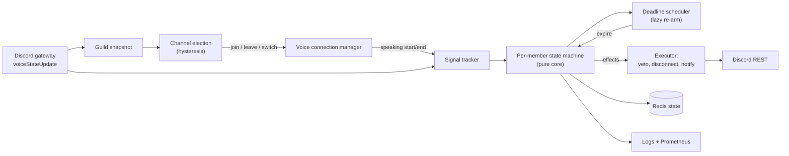

# AFK Guard

A Discord bot that watches the **busiest voice channel** in a server and disconnects members who have produced **no audio for 5 minutes**, posting a notice in the channel so everyone knows a spot just opened up.

> **Status:** Project skeleton in place (tooling, config loader, CI). Phase 0 (platform verification) is next. Nothing in this README is measured yet. The measurement plan lives in [docs/METRICS.md](docs/METRICS.md), and every number published here will link to the command that produced it.

## Why this exists

Full or crowded voice channels often hold people who walked away from their mic. Everyone else sees a packed call, or a call that hits its user limit, and does not join. AFK Guard frees those spots and tells the channel it did.

Discord has a built-in inactivity mover, but it is based on client idleness, not on whether anyone is actually producing audio in the call. AFK Guard watches real voice activity.

## What it does

- Monitors **one voice channel per server: the one with the most humans in it**.
- Tracks the last time each member produced audio (speaking signal only; audio is never decoded, recorded, or stored).
- After **5 minutes of silence** (configurable), disconnects that member, then posts a notice in the channel.
- Exempts members who are streaming, on camera, holding an exempt role, or who have opted out.
- Ships with a **dry-run mode** that logs what it would do without disconnecting anyone.

## How it works



Full detail: [docs/ARCHITECTURE.md](docs/ARCHITECTURE.md).

## Design highlights

| Decision | Why it matters | ADR |
|---|---|---|
| One monitored channel per server | A bot can hold only one voice connection per guild; this turns the limit into a feature | [0001](docs/adr/0001-single-monitored-channel.md) |
| Speaking signal, never audio decoding | Discord voice is end-to-end encrypted (DAVE); decoding audio is heavy, fragile, and a privacy risk | [0002](docs/adr/0002-speaking-signal-not-audio.md) |
| Deadline scheduler with lazy re-arm | No polling loop; speaking events are O(1) writes | [0003](docs/adr/0003-lazy-deadline-scheduler.md) |
| Election hysteresis | Stops the bot from hopping between channels when counts fluctuate | [0004](docs/adr/0004-election-hysteresis.md) |
| Blind-interval accounting | Reconnects and restarts never count as member silence | [0005](docs/adr/0005-blind-interval-accounting.md) |
| Disconnect, then notify, with last-moment veto | Never announce an action that did not happen; never kick someone who just spoke | [0006](docs/adr/0006-action-safety.md) |
| AI stays out of the action path | Classifier in shadow mode only; LLM limited to admin configuration | [0007](docs/adr/0007-ai-placement.md) |

## Constraints designed around

- **One voice connection per guild.** Discord allows a bot a single voice connection in each server.
- **End-to-end encrypted voice (DAVE).** Required for Discord voice since March 2026. Voice-receiving libraries had early DAVE issues, so the library version is pinned and verified in Phase 0.
- **Speaking events are packet-driven.** They fire when audio packets arrive, with a short end delay. The bot must join undeafened. A noisy open mic counts as activity.

## Known limitations (read before deploying)

- **Silent listeners look identical to people who left.** Someone muted but listening to friends talk produces no audio. Mitigations: dry-run first, exemptions, an optional "I'm here" grace flow, and the adaptive classifier in Phase 6.
- The bot is visible in the channel. Whether it consumes a slot in a user-limited channel must be verified (see Phase 0).
- Monitors one channel per server by design. Other channels are not watched.

## Tech stack

TypeScript (strict, ESM), Node.js LTS, discord.js, @discordjs/voice, Redis (ioredis), zod, pino, prom-client, Vitest, fast-check, Stryker (mutation testing), Docker, GitHub Actions.
Optional AI phases: Python + scikit-learn (offline training), Anthropic API, Langfuse.

## Configuration (defaults)

| Variable | Default | Meaning |
|---|---|---|
| `SILENCE_THRESHOLD_SECONDS` | 300 | Silence before action |
| `MIN_HUMANS` | 2 | Minimum humans for a channel to be monitored |
| `SWITCH_MARGIN` | 2 | Extra humans a challenger needs to take over |
| `ELECTION_STABLE_SECONDS` | 20 | How long the lead must hold before switching |
| `MIN_DWELL_SECONDS` | 60 | Minimum time in a channel before voluntary switch |
| `GRACE_SECONDS` | 0 | Optional warning period before disconnect |
| `DRY_RUN` | true | Log decisions without disconnecting |
| `EXEMPT_STREAMING` / `EXEMPT_CAMERA` | true | Skip streamers and camera users |

All variables: [.env.example](.env.example). Behavior spec: [docs/SPEC.md](docs/SPEC.md).

## Discord setup (preview)

Required permissions: View Channel, Connect, Send Messages (in the voice channel's text chat), **Move Members** (needed to disconnect members).
Required intents: `Guilds`, `GuildVoiceStates` (no privileged intents planned; verified in Phase 0).
Step-by-step setup instructions will be added in Phase 2.

## Privacy

Processes Discord user IDs, voice-state flags, and timestamps of when someone produced audio. Never audio content. See [PRIVACY.md](PRIVACY.md).

## Development

Requires Node.js 22.12 or newer (see `.nvmrc`).

```sh
npm ci                 # install exact pinned versions
npm run lint           # ESLint, including the core-purity rule for /src/core
npm run typecheck      # tsc in strict mode
npm test               # Vitest unit and property-based tests
npm run voice:report   # which voice encryption/DAVE/Opus libraries @discordjs/voice can find
```

Copy `.env.example` to `.env` for local runs. Never commit `.env`.

Layout: `src/core` (pure decision logic, no I/O or ambient time), `src/app` (orchestration and config), `src/adapters` (Discord, Redis, metrics), `src/sim` (simulator), `test`, `scripts`.

## Project docs

| Doc | Purpose |
|---|---|
| [docs/SPEC.md](docs/SPEC.md) | Requirements, behavior, edge cases |
| [docs/ARCHITECTURE.md](docs/ARCHITECTURE.md) | Components, algorithms, failure modes |
| [docs/adr/](docs/adr/README.md) | Architecture decision records |
| [docs/ROADMAP.md](docs/ROADMAP.md) | Phases, definitions of done, Claude Code prompts |
| [docs/TESTING.md](docs/TESTING.md) | Test strategy and invariants |
| [docs/METRICS.md](docs/METRICS.md) | What gets measured, and how |
| [SECURITY.md](SECURITY.md) | Reporting and hardening |

## Roadmap

- [ ] Phase 0: Verify platform behavior (DAVE, speaking events, permissions)
- [ ] Phase 1: Pure core and deterministic simulator
- [ ] Phase 2: Discord adapters and commands
- [ ] Phase 3: Reliability (Redis, reconcile, graceful shutdown)
- [ ] Phase 4: Observability, CI/CD, containers, soak test
- [ ] Phase 5: Dry-run dogfooding and measurement
- [ ] Phase 6: Adaptive decision layer (shadow mode)
- [ ] Phase 7: Natural-language admin config (optional)
- [ ] Phase 8: Polish and results

## Results

Not yet measured. See [docs/METRICS.md](docs/METRICS.md).

## License

MIT. See [LICENSE](LICENSE).
